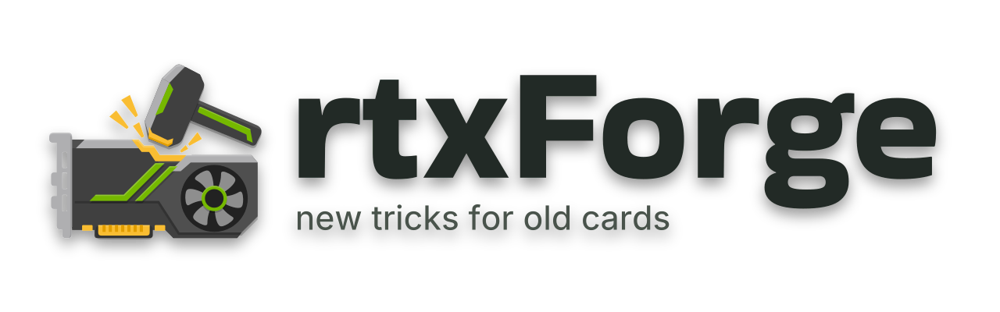

<picture>
  <source media="(prefers-color-scheme: dark)" srcset="packaging/steam-artwork/exports/rtxforge-logo-white.png">
  
</picture>

# rtxForge

Deploy neural rendering across compatible games, bring multi-frame generation to RTX 20, 30 and 40 series (RTX 50 uses its own), and keep DLSS files up to date. Native apps for Linux and Windows, with reviewed changes and original-file backups.

**[Website & downloads](https://rtxforge.loew.fi/) · [Installation guide](https://rtxforge.loew.fi/install) · [Report a bug](https://github.com/lrnolivia/rtxForge/issues)**

## Download

| Channel | What to expect |
| --- | --- |
| **Beta** | The regular public testing release. Start here. |
| **Development** | A moving release with the latest changes and unfinished features. |

[**rtxForge Beta 1 is available for Linux and Windows.**](https://github.com/lrnolivia/rtxForge/releases/tag/beta) [Choose your OS on the website](https://loew.fi/rtxforge/#downloads) for downloads and installation instructions. Linux x86_64 offers a Flatpak bundle and AppImage; Windows offers x64 and ARM64 installers and an x64 portable ZIP.

Beta 1 is the public release label. Its current package version is `1.0.0-beta.9` on both Linux and Windows; build numbers remain separate from the public label. The channels use the `beta` and `development` release tags. The site shows **coming soon** only when a channel has no published package for your OS. The older `continuous` prerelease remains for existing Linux updater compatibility. Release channels are separate from source-code branches.

Updates download and verify in the background by default. The installed Windows app, Linux AppImage and standard user/system Flatpak install the ready update when you close rtxForge; **Restart to update** applies it sooner and reopens your interface. Close games before installation. Turn **Automatic updates** off in Settings to check manually. Portable Windows ZIPs are updated by extracting the new ZIP; custom Flatpak installations use their software manager. Settings and game backups stay in place. Existing builds need one update to Beta 9 to gain this behavior.

### Download directly from GitHub

1. Open **[Releases](https://github.com/lrnolivia/rtxForge/releases)** on this repository.
2. Choose **rtxForge Beta 1** (`beta`), or **rtxForge Development** (`development`) when published.
3. Expand **Assets** and download the package for your OS: Linux `.flatpak` or `.AppImage`; Windows setup `.exe` for your architecture or the x64 portable Windows ZIP. Files containing `.previous-` are retained recovery copies.
4. Run the installer, or extract the entire portable ZIP and open `rtxForge.exe`. For Linux setup, follow the [installation guide](https://rtxforge.loew.fi/install?os=linux).

The automatic **Source code (zip)** and **Source code (tar.gz)** links contain the source, not the ready-to-run app. Checksum files are for verifying a download.

### Linux setup

The Linux beta targets Bazzite, SteamOS and CachyOS. Use the **Flatpak bundle** on SteamOS; it also runs on Bazzite and CachyOS and supplies GTK4/libadwaita through the GNOME runtime. Open the downloaded `.flatpak` in Discover or GNOME Software, or install it with `flatpak install --user /path/to/download.flatpak`.

The **AppImage** uses host Python 3, GTK4, libadwaita 1.7+ and PyGObject. On CachyOS, install `python-gobject` and `libadwaita` first. Allow the AppImage to run in its file properties, then open it. Both formats require host Python 3 for system checks. See the [Linux installation guide](https://loew.fi/rtxforge/install?os=linux) and [release notes](https://github.com/lrnolivia/rtxForge/releases/tag/beta) for requirements and testing limits.

## Your first game

1. **Find your game.** Rescan the Library or add its folder. Start with one compatible title.
2. **Choose your packages.** Select a supported provider and NR Only, MFG Only or NR + MFG.
3. **Tune presets.** Set library defaults in Presets, then adjust individual games as needed.
4. **Install.** Close the game, choose **Install Features**, review the changes and apply. Follow any Steam or compatibility instructions in the review.
5. **Play.** Enable the in-game DLSS and frame-generation options required by your package. Check the result before expanding to more games.

Need to undo it? **Restore Original Files** uses your feature-install backups. **DLSS Files** has separate restore controls for native DLL updates. Keep your recovery records and backups.

The [full installation guide](https://rtxforge.loew.fi/install) covers app setup, packages, presets, installation, updates, recovery and troubleshooting for both OSes.

## Compatibility

- NR is experimental and requires a compatible RTX card, game and provider. MFG supports RTX 20, 30 and 40 series on compatible routes; RTX 50 uses its own MFG and rtxForge installs no unlock for it. Under Proton, MFG is offered on RTX 40 and RTX 50 (not yet verified on RTX 50). A requested multiplier is not a guaranteed net FPS gain.
- Package support differs between Linux and Windows. Beta 1 includes Game Mode and in-game overlay/panel features, with testing limits listed in the release notes. **Adapt to Linux** sets up supported Windows-installed games on a shared drive without changing their Windows installation. Proton frame generation needs a build with NVIDIA CUDA support, such as Proton-GE; launch the game once with that build before adapting it.
- Close games before changing their files. Avoid protected online games and anti-cheat; review conflicts rather than overwriting unknown files.

## Help

[Read troubleshooting](https://rtxforge.loew.fi/install#help) or [report a bug](https://loew.fi/rtxforge/report). Include your OS, app build, GPU/driver, game, provider and what happened.

In the app, **Bug Report** (on every game, or Settings › About) fills in those details for you. **Send Report** files it as a GitHub issue through the [report service](services/reports/README.md), with no GitHub account needed. Redacted logs are optional and go privately to the maintainers; the issue itself is public. Reviewed reports feed the [compatibility list](docs/COMPATIBILITY.md).

## Development

See [Development](docs/DEVELOPMENT.md) for the shared engine, checks and contribution workflow, [Windows](windows/README.md) for native build instructions, and [DLSS Files](docs/DLSS-FILES.md) for its backup and restore behavior. Provider-specific requirements belong with the selected package and its release notes.

## License and notices

rtxForge is released under the [MIT License](LICENSE). Runtime packages retain their upstream terms. Font notices are preserved for [Bakbak One](gui/fonts/OFL-BakbakOne.txt) and [Inter](packaging/steam-artwork/source/OFL-Inter.txt).

See [code signing status](CODE_SIGNING.md) for Windows packages.
